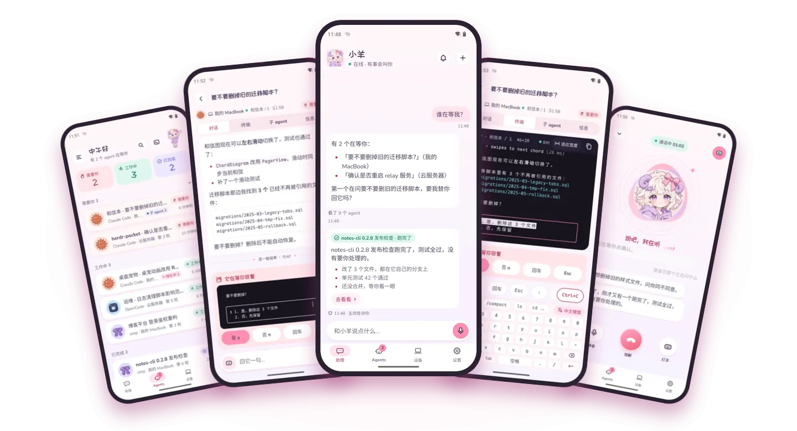
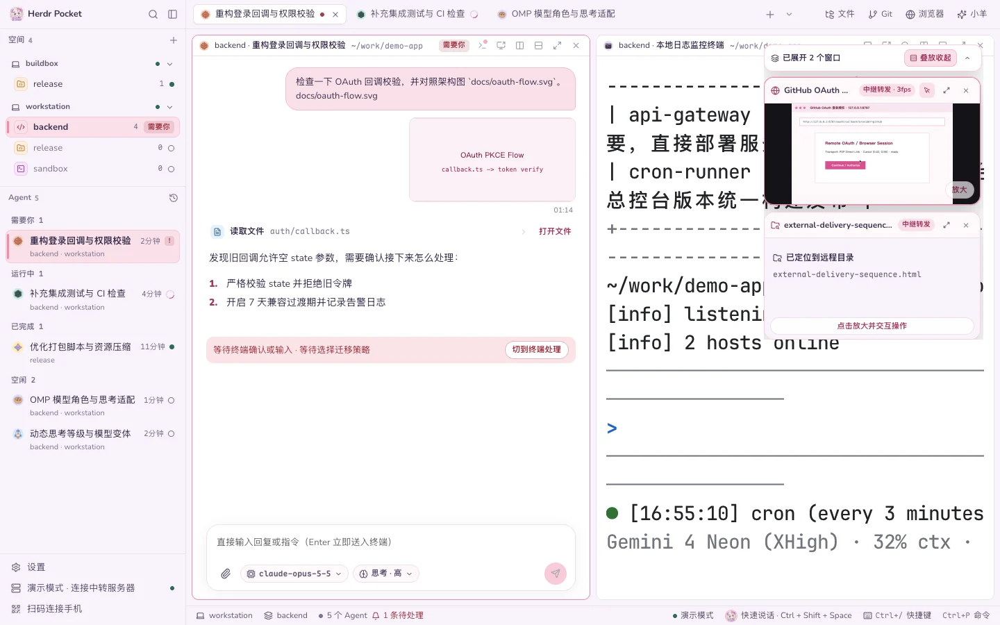
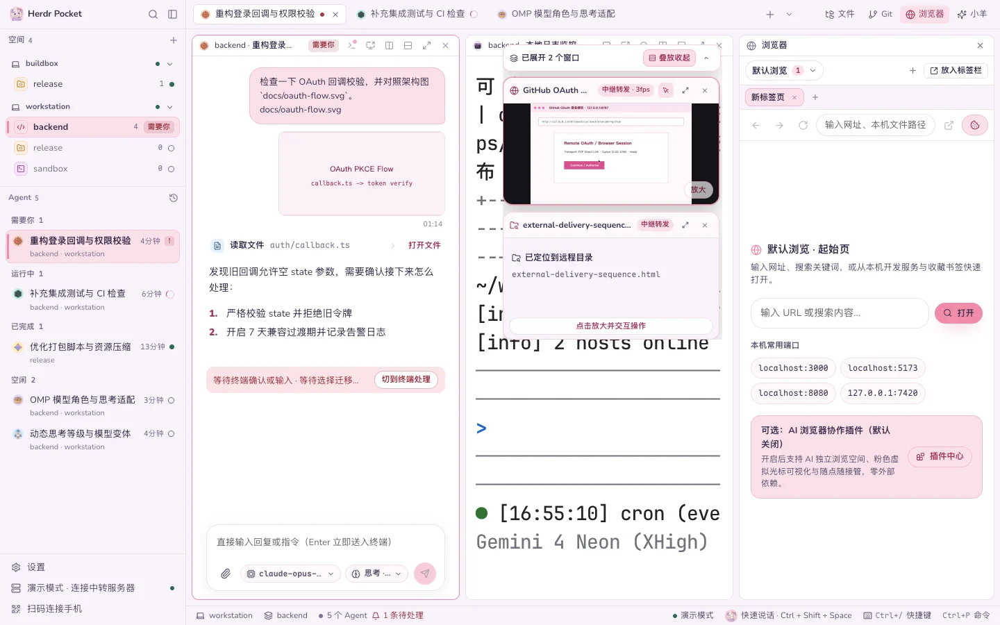
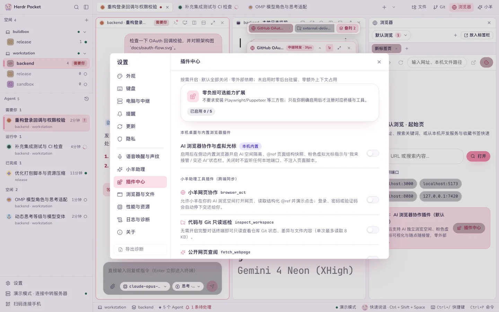

<p align="center">
  <picture>
    <source media="(prefers-color-scheme: dark)" srcset="docs/readme/hero-en-dark.svg" />
    <source media="(prefers-color-scheme: light)" srcset="docs/readme/hero-en-light.svg" />
    
  </picture>
</p>

<p align="center">
  <strong>Control AI coding agents across every computer — from iOS, Android, HarmonyOS NEXT, macOS, Windows, Linux, or any browser.</strong>
</p>

<p align="center">
  <a href="README.md"><strong>English</strong></a> ·
  <a href="README.zh-CN.md">简体中文</a> ·
  <a href="https://crosery.github.io/herdr-pocket/">Official Website</a> ·
  <a href="https://github.com/Crosery/herdr-pocket/releases">Releases (v0.2.45)</a> ·
  <a href="docs/deploy/README.md">Self-Hosting Docs</a>
</p>

<p align="center">
  
  
  
</p>

---

## Multi-Device Workspace Showcase

<p align="center">
  <picture>
    <source media="(prefers-color-scheme: dark)" srcset="docs/readme/showcase-dark.webp" />
    <source media="(prefers-color-scheme: light)" srcset="docs/readme/showcase-light.webp" />
    
  </picture>
</p>

<table align="center">
  <tr>
    <td align="center" width="33.3%">
      
      <br />
      <strong>v3 Split &amp; Stacked Workbench</strong>
      <br />
      <sub>Multi-pane workspaces, <code>/</code> &amp; <code>\</code> command surface, Intent Spaces &amp; Git Worktree isolation.</sub>
    </td>
    <td align="center" width="33.3%">
      
      <br />
      <strong>Space Browser &amp; AI Virtual Cursor</strong>
      <br />
      <sub>Multi-space tabs, optional AI pink virtual cursor overlay, CAPTCHA guard &amp; instant human takeover.</sub>
    </td>
    <td align="center" width="33.3%">
      
      <br />
      <strong>Opt-In Plugin Center</strong>
      <br />
      <sub>All plugins off by default: enable <code>browser_act</code>, workspace inspection, SSRF-safe web fetch, or custom webhooks only when needed.</sub>
    </td>
  </tr>
</table>

---

## Direct Downloads (`v0.2.45`)

Every build below comes straight from [GitHub Releases](https://github.com/Crosery/herdr-pocket/releases) alongside `SHA256SUMS` and Chinese/English release notes.

| Platform | Architecture / Format | Direct Download | Notes |
| --- | --- | --- | --- |
| **macOS** | Apple Silicon (`arm64`) `.dmg` | [herdr-pocket-0.2.49-macos-arm64.dmg](https://github.com/Crosery/herdr-pocket/releases/download/v0.2.49/herdr-pocket-0.2.49-macos-arm64.dmg) | Tauri v2 desktop app (M1–M4) |
| **macOS** | Intel (`x64`) `.dmg` | [herdr-pocket-0.2.49-macos-x64.dmg](https://github.com/Crosery/herdr-pocket/releases/download/v0.2.49/herdr-pocket-0.2.49-macos-x64.dmg) | Tauri v2 desktop app (x86_64) |
| **Windows** | `x64` NSIS Installer `.exe` | [herdr-pocket-0.2.49-windows-x64-setup.exe](https://github.com/Crosery/herdr-pocket/releases/download/v0.2.49/herdr-pocket-0.2.49-windows-x64-setup.exe) | Recommended Windows installer |
| **Windows** | `x64` Windows Installer `.msi` | [herdr-pocket-0.2.49-windows-x64.msi](https://github.com/Crosery/herdr-pocket/releases/download/v0.2.49/herdr-pocket-0.2.49-windows-x64.msi) | Enterprise / MSI deployment |
| **Linux** | `x64` Portable `.AppImage` | [herdr-pocket-0.2.49-linux-x64.AppImage](https://github.com/Crosery/herdr-pocket/releases/download/v0.2.49/herdr-pocket-0.2.49-linux-x64.AppImage) | Zero-install portable image |
| **Linux** | `x64` Debian/Ubuntu `.deb` | [herdr-pocket-0.2.49-linux-x64.deb](https://github.com/Crosery/herdr-pocket/releases/download/v0.2.49/herdr-pocket-0.2.49-linux-x64.deb) | `apt` / `dpkg` package |
| **Android** | `arm64` Native `.apk` | [herdr-pocket-0.2.49-android-arm64.apk](https://github.com/Crosery/herdr-pocket/releases/download/v0.2.49/herdr-pocket-0.2.49-android-arm64.apk) | In-app self-update &amp; voice mode |
| **HarmonyOS NEXT** | `arm64` Stage-Model `.hap` | [herdr-pocket-0.2.49-harmonyos-arm64.hap](https://github.com/Crosery/herdr-pocket/releases/download/v0.2.49/herdr-pocket-0.2.49-harmonyos-arm64.hap) | Native ArkTS shell + Web workbench |
| **iOS** | `arm64` Sideload `.ipa` | [herdr-pocket-0.2.49-ios-arm64.ipa](https://github.com/Crosery/herdr-pocket/releases/download/v0.2.49/herdr-pocket-0.2.49-ios-arm64.ipa) | AltStore / SideStore / TrollStore |
| **Relay &amp; Hostd** | Cross-platform `.tar.gz` | [herdr-pocket-0.2.49.tar.gz](https://github.com/Crosery/herdr-pocket/releases/download/v0.2.49/herdr-pocket-0.2.49.tar.gz) | Used by `install-host` &amp; `herdr-pocket update` |

---

## Core Capabilities

<p align="center">
  <picture>
    <source media="(prefers-color-scheme: dark)" srcset="docs/readme/features-en-dark.svg" />
    <source media="(prefers-color-scheme: light)" srcset="docs/readme/features-en-light.svg" />
    
  </picture>
</p>

### 1. Real-Time Agent Control Without Changing Your CLI Workflow
- **Multi-harness support**: Keep running Claude Code, Codex, OpenCode, Gemini CLI, OMP, or plain shells inside `herdr` on macOS, Linux, or Windows — Pocket attaches without wrapping or breaking your workflow.
- **Unified `/` & `\` Command Surface**: Typing `/` or `\` opens a synchronized command popup (`/clear`, `/compact`, `/model`, `/resume`, etc.) across mobile, desktop, and H5.
- **Intent-First Create Space & Git Worktree**: Pick what you want to do, choose your harness and launcher, and optionally spin up an isolated Git Worktree branch in one tap so parallel tasks never collide in one working tree.
- **Native Terminal + Conversation Stream**: Switch cleanly between structured chat turns (diffs, tool cards, permissions, questions) and crisp native xterm rendering with live terminal graphics.

### 2. Multi-Space & Multi-Tab Browser + Opt-In AI Virtual Cursor (`plugins.aiBrowser`, off by default)
- **Workspace-grade browser spaces**: Organize dev previews, docs, and login sessions into separate browser spaces and multi-tab panes directly inside the desktop workbench.
- **Zero-dependency AI automation when you turn it on**: Keep `plugins.aiBrowser` disabled for zero footprint; flip it on to let agents inspect interactive elements (`@e1`, `@e2`), click, fill, select, scroll, press keys, and stream what they are doing.
- **Pink Virtual Cursor & Live Human Takeover**: Watch the closed Shadow DOM pink cursor glide across targets with status banners, trigger `我来接管` / `已完成，交还 AI` at any moment, and rely on built-in CAPTCHA / password human-handoff guards.
- **Scriptable CLI & RPC (`hostd`)**: Drive spaces from agents or scripts via `herdr-pocket browser`:

```sh
herdr-pocket browser status --json
herdr-pocket browser open http://localhost:3000 --space work --page app
herdr-pocket browser snapshot --space work --json
herdr-pocket browser click @e12 --space work --label "Submit login form"
herdr-pocket browser fill @e14 "hello" --space work
herdr-pocket browser handoff --space work --reason "Need human SMS verification"
herdr-pocket browser resume --space work
```

### 3. Xiaoyang Assistant & Opt-In Plugin Center (`插件中心`, all `false` by default)
- **Clean by default, extensible on demand**: Every plugin starts `false` — no surprise background tools, no heavy external dependencies, and zero lock-in.
- **Built-in Xiaoyang Plugins**: Enable only what you trust in Desktop/Mobile **Plugin Center**:
  - `browser` (`browser_act`): Let Xiaoyang interact with your Space Browser while staying subject to human handoff rules.
  - `workspace` (`inspect_workspace`): Safely inspect repository layout and files with bounded output.
  - `webfetch` (`fetch_webpage`): Fetch web documentation with DNS/IP SSRF blocking (rejects loopback, link-local, RFC1918, and IPv6 ULA targets, including redirects) and 8 KB text truncation.
  - `webhooks`: Register custom HTTP webhook tools whose bearer secrets are sealed at rest and masked (`••••••••`) across read APIs.

### 4. P2P Cross-Device Portal & Direct File Transfer
- Run `herdr-pocket open <url-or-file>` from any paired machine or trigger URL/file hooks inside tmux — Pocket detects LAN or WireGuard/Tailscale peers automatically for direct encrypted P2P transfer, falling back seamlessly to your relay.

---

## Visual Architecture & AI Ecosystem

<table align="center">
  <tr>
    <td align="center" width="33.3%">
      
      <br />
      <sub>Multi-device unified cockpit</sub>
    </td>
    <td align="center" width="33.3%">
      
      <br />
      <sub>AI Virtual Cursor &amp; Human Takeover</sub>
    </td>
    <td align="center" width="33.3%">
      
      <br />
      <sub>Xiaoyang Opt-In Plugin Center</sub>
    </td>
  </tr>
</table>

<p align="center">
  <picture>
    <source media="(prefers-color-scheme: dark)" srcset="docs/readme/architecture-en-dark.svg" />
    <source media="(prefers-color-scheme: light)" srcset="docs/readme/architecture-en-light.svg" />
    
  </picture>
</p>

### How It Works
- **`apps/relay`**: Lightweight WebSocket + HTTP relay (`Node.js` + SQLite). Stores hashed device tokens (`SHA-256`), manages Xiaoyang assistant state/sealed keys, serves the H5 client (`/app/`), and relays frames when direct P2P isn't reachable.
- **`apps/hostd`**: Per-computer daemon (`herdr-pocket`). Bridges local `herdr` TUI sockets, Uniflo session logs, Git worktree creation, Portal P2P transfers, and the optional Chromium/bridge AI browser controller.
- **Clients**:
  - `apps/desktop`: **React 19 + Tauri v2** native app for macOS, Windows, and Linux.
  - `apps/mobile`: **Expo SDK 58** native app for Android and iOS.
  - `apps/harmony`: **HarmonyOS NEXT** Stage-Model ArkTS shell wrapping the shared workbench bundle.

---

## Quickstart

### 1. Deploy Your Own Relay (2 Minutes)

Pick Docker, native Node + systemd, Fly.io, Render, Kubernetes, or Cloudflare Tunnel without opening firewall ports ([Deployment Guide](docs/deploy/README.md)):

```sh
curl -fsSL https://raw.githubusercontent.com/Crosery/herdr-pocket/main/scripts/install-relay.sh | sudo bash -s -- --domain pocket.example.com
```

### 2. Connect Each Computer (`hostd`)

**macOS / Linux:**

```sh
curl -fsSL https://raw.githubusercontent.com/Crosery/herdr-pocket/main/scripts/install-host.sh | bash -s -- --server https://pocket.example.com
```

**Windows (PowerShell):**

```powershell
& ([scriptblock]::Create((irm https://raw.githubusercontent.com/Crosery/herdr-pocket/main/scripts/install-host.ps1))) -Server https://pocket.example.com
```

*Mainland China mirror supported:* prepend `https://ghfast.top/` before the script URL or run `herdr-pocket update --probe` to benchmark fastest download sources automatically.

### 3. Open Pocket on Phone or Desktop

Install the native app from [Direct Downloads](#direct-downloads-v0245), pair once via invite link or QR code (`herdr-pocket pair`), or visit `https://<your-relay>/app/` in any browser.

---

## Security & Trust Model

- **Relay sees plaintext on the wire inside TLS**: Frames between clients and hosts are authenticated and TLS-encrypted in transit, **not** end-to-end encrypted against the relay operator — which is why Herdr Pocket makes self-hosting effortless and under your full control.
- **Zero-trust defaults**: All AI Browser & Xiaoyang plugins ship **disabled (`false`)**, private IP fetches are blocked by SSRF validation, webhook secrets and LLM API keys are encrypted on disk with `<db>.key` and masked in UI responses, and device tokens are stored only as hashes.

---

## Development

```sh
pnpm install
pnpm typecheck
pnpm --filter @herdr-pocket/relay test
pnpm --filter @herdr-pocket/hostd test
pnpm --dir apps/desktop typecheck && pnpm --dir apps/desktop test
pnpm --dir apps/mobile typecheck
```

See [AGENTS.md](AGENTS.md) and [docs/design/ui-component-rules.md](docs/design/ui-component-rules.md) for UI primitive rules, workspace build instructions, and release conventions.

---

## License

Copyright © 2026 Crosery

Herdr Pocket is released under the [GNU Affero General Public License v3.0 only](LICENSE) (AGPL-3.0-only):

- You may freely use, study, modify and redistribute it, including commercially.
- If you distribute a modified version (an installer, an image, an archive), you must include the complete source under the same license.
- Even if you only deploy a modified relay or app for others to use over a network, without distributing the program, you must make the modified source available to those users. This is where the AGPL is stricter than the GPL.
- You may not fold it, or any part of it, into a closed-source product.
- This license grants no trademark rights to the “Herdr Pocket” name or logo. If you publish a modified version, give it a different name and package name, so nobody mistakes it for the official one.

**Additional permission under AGPL-3.0 section 7.** The website in `apps/site` may be combined with GSAP (distributed under its own “Standard no-charge” license), and the intro video project in `apps/site/video` with Remotion (distributed under the Remotion License), without those libraries falling under the AGPL. They keep their own terms: Remotion, for example, requires a paid company license above a certain team size. Neither library is used by the relay, the computer daemon or the mobile and desktop client apps.
