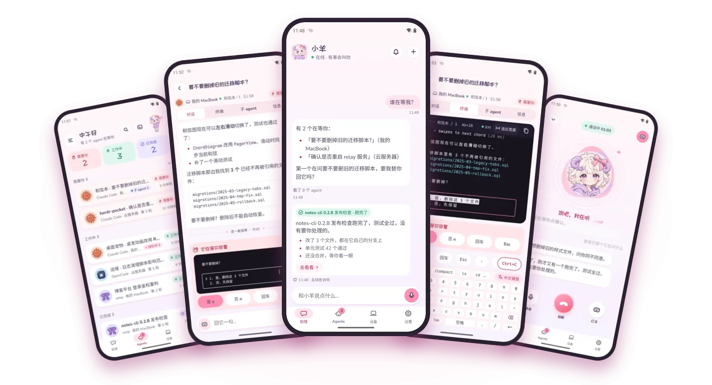
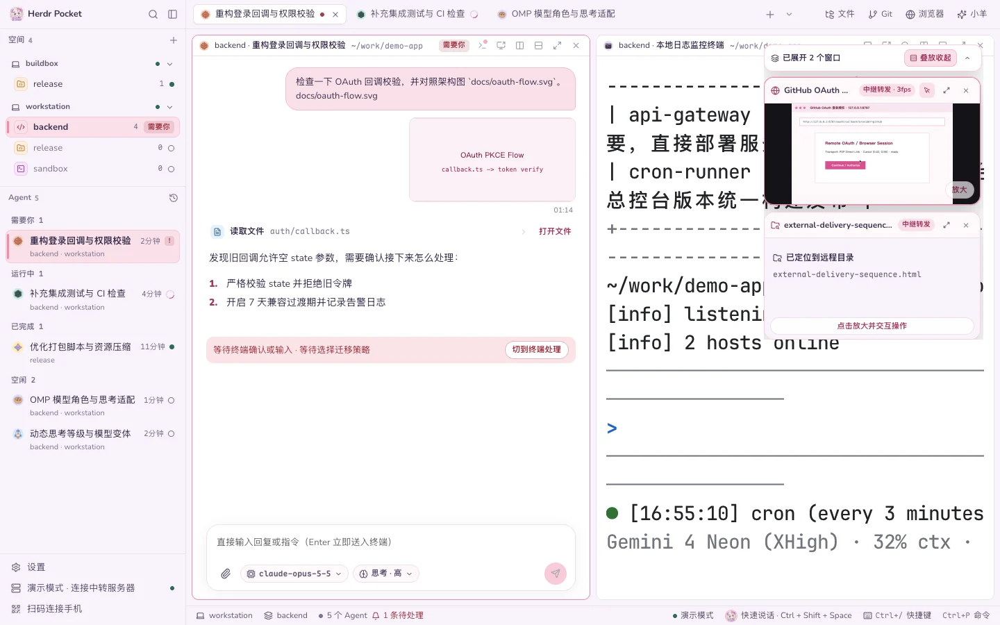
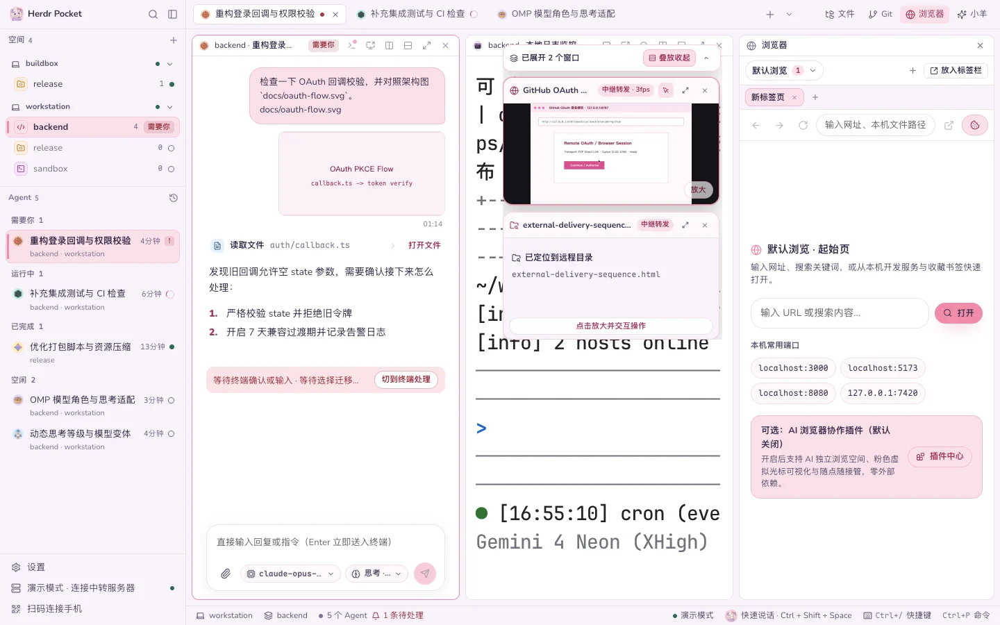
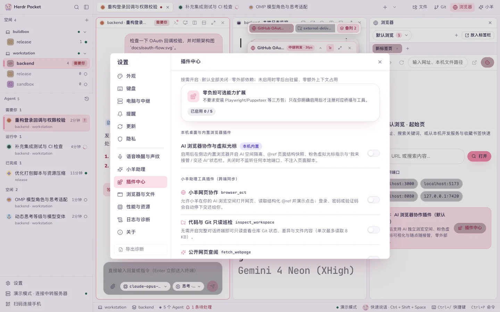

<p align="center">
  <picture>
    <source media="(prefers-color-scheme: dark)" srcset="docs/readme/hero-zh-dark.svg" />
    <source media="(prefers-color-scheme: light)" srcset="docs/readme/hero-zh-light.svg" />
    
  </picture>
</p>

<p align="center">
  <strong>用手机、平板或桌面端实时接管每台电脑上的 AI 编程 Agent —— 原生支持 iOS、Android、HarmonyOS NEXT、macOS、Windows、Linux 与网页 H5。</strong>
</p>

<p align="center">
  <a href="README.md">English</a> ·
  <a href="README.zh-CN.md"><strong>简体中文</strong></a> ·
  <a href="https://crosery.github.io/herdr-pocket/">官方网站</a> ·
  <a href="https://github.com/Crosery/herdr-pocket/releases">全部发布包 (v0.2.45)</a> ·
  <a href="docs/deploy/README.md">自托管部署指南</a>
</p>

<p align="center">
  
  
  
</p>

---

## 全端效果一览

<p align="center">
  <picture>
    <source media="(prefers-color-scheme: dark)" srcset="docs/readme/showcase-dark.webp" />
    <source media="(prefers-color-scheme: light)" srcset="docs/readme/showcase-light.webp" />
    
  </picture>
</p>

<table align="center">
  <tr>
    <td align="center" width="33.3%">
      
      <br />
      <strong>v3 分屏与堆叠工作台</strong>
      <br />
      <sub>多栏协作视图、<code>/</code> 与 <code>\</code> 统一斜杠命令面板、意图驱动创建空间与 Git Worktree 隔离。</sub>
    </td>
    <td align="center" width="33.3%">
      
      <br />
      <strong>多空间浏览器与 AI 虚拟光标</strong>
      <br />
      <sub>Space 标签隔离、按需开启的粉色虚拟鼠标轨迹、验证码保护与一键人类接管。</sub>
    </td>
    <td align="center" width="33.3%">
      
      <br />
      <strong>按需启用的插件中心</strong>
      <br />
      <sub>全部插件默认关闭、零强依赖：仅在认可并需要时手动开启浏览器操控、工作区巡检、安全抓取与 Webhook。</sub>
    </td>
  </tr>
</table>

---

## 全平台安装包直链（`v0.2.45`）

以下安装包均由 GitHub Actions 自动构建并附带 `SHA256SUMS` 与中文更新说明，也可直接前往 [Releases 页面](https://github.com/Crosery/herdr-pocket/releases) 下载。

| 平台 | 架构 / 格式 | 直接下载链接 | 说明 |
| --- | --- | --- | --- |
| **macOS** | Apple Silicon (`arm64`) `.dmg` | [herdr-pocket-0.2.45-macos-arm64.dmg](https://github.com/Crosery/herdr-pocket/releases/download/v0.2.45/herdr-pocket-0.2.45-macos-arm64.dmg) | M1–M4 原生 Tauri v2 桌面端 |
| **macOS** | Intel (`x64`) `.dmg` | [herdr-pocket-0.2.45-macos-x64.dmg](https://github.com/Crosery/herdr-pocket/releases/download/v0.2.45/herdr-pocket-0.2.45-macos-x64.dmg) | Intel Mac 桌面端 |
| **Windows** | `x64` NSIS 安装器 `.exe` | [herdr-pocket-0.2.45-windows-x64-setup.exe](https://github.com/Crosery/herdr-pocket/releases/download/v0.2.45/herdr-pocket-0.2.45-windows-x64-setup.exe) | 推荐的标准安装向导 |
| **Windows** | `x64` `.msi` 安装包 | [herdr-pocket-0.2.45-windows-x64.msi](https://github.com/Crosery/herdr-pocket/releases/download/v0.2.45/herdr-pocket-0.2.45-windows-x64.msi) | 静默 / MSI 部署包 |
| **Linux** | `x64` 便携镜像 `.AppImage` | [herdr-pocket-0.2.45-linux-x64.AppImage](https://github.com/Crosery/herdr-pocket/releases/download/v0.2.45/herdr-pocket-0.2.45-linux-x64.AppImage) | 免安装运行 |
| **Linux** | `x64` Debian/Ubuntu `.deb` | [herdr-pocket-0.2.45-linux-x64.deb](https://github.com/Crosery/herdr-pocket/releases/download/v0.2.45/herdr-pocket-0.2.45-linux-x64.deb) | `apt` / `dpkg` 安装包 |
| **Android** | `arm64` 原生 `.apk` | [herdr-pocket-0.2.45-android-arm64.apk](https://github.com/Crosery/herdr-pocket/releases/download/v0.2.45/herdr-pocket-0.2.45-android-arm64.apk) | 支持应用内一键更新与语音唤醒 |
| **HarmonyOS NEXT** | `arm64` 原生 `.hap` | [herdr-pocket-0.2.45-harmonyos-arm64.hap](https://github.com/Crosery/herdr-pocket/releases/download/v0.2.45/herdr-pocket-0.2.45-harmonyos-arm64.hap) | Stage 模型 ArkTS 原生外壳 |
| **iOS** | `arm64` 侧载包 `.ipa` | [herdr-pocket-0.2.45-ios-arm64.ipa](https://github.com/Crosery/herdr-pocket/releases/download/v0.2.45/herdr-pocket-0.2.45-ios-arm64.ipa) | 兼容 AltStore / SideStore / TrollStore |
| **中转与守护进程** | 跨平台源码包 `.tar.gz` | [herdr-pocket-0.2.45.tar.gz](https://github.com/Crosery/herdr-pocket/releases/download/v0.2.45/herdr-pocket-0.2.45.tar.gz) | `install-host` 与 `herdr-pocket update` 使用 |

---

## 核心能力矩阵

<p align="center">
  <picture>
    <source media="(prefers-color-scheme: dark)" srcset="docs/readme/features-zh-dark.svg" />
    <source media="(prefers-color-scheme: light)" srcset="docs/readme/features-zh-light.svg" />
    
  </picture>
</p>

### 1. 不改变终端习惯的全端 Agent 控制
- **完整保留原汁原味的 CLI 工作流**：在 macOS / Linux / Windows 电脑上继续用你熟悉的 Claude Code、Codex、OpenCode、Gemini CLI 或 OMP，Pocket 通过 `hostd` 守护进程无侵入接入。
- **`/` 与 `\` 同步 CLI 命令面板**：在对话输入框敲 `/` 或 `\` 即可呼出统一同步的斜杠命令面板（`/clear`、`/compact`、`/model`、`/resume` 等），不再因入口不同而漏掉快捷指令。
- **意图优先「创建空间」与 Git Worktree 隔离**：选定任务意图即可记住常用工具组合，支持一键开启 Git Worktree 隔离分支，多任务并行互不干扰。
- **对话流与原生终端无缝切换**：随时在结构化工具卡片、代码 Diff、审批确认与高精度 xterm 原生终端之间切换。

### 2. 多空间浏览器与可选 AI 虚拟光标（`plugins.aiBrowser`，默认关闭）
- **Space 隔离 + 多标签页**：桌面工作台内置多空间、多标签浏览器面板，把本地开发预览、文档和业务控制台分门别类管好，互不串 Cookie 与上下文。
- **零外部依赖、默认不打扰**：在未主动启用 `plugins.aiBrowser` 前完全零感知；当你需要 AI 帮忙操作网页时再开启，无需安装额外浏览器扩展或重型运行环境。
- **实时状态栏 + 粉色虚拟鼠标 + 一键接管**：闭合 Shadow DOM 渲染高精度粉色虚拟光标与当前动作状态栏，遇到登录、密码或验证码自动触发人类接管保护，也可随时点击 **「我来接管」 / 「已完成，交还 AI」**。
- **CLI 与 RPC 全链路可控**：Agent 或脚本可通过 `herdr-pocket browser` 直接操控：

```sh
herdr-pocket browser status --json
herdr-pocket browser open http://localhost:3000 --space work --page app
herdr-pocket browser snapshot --space work --json
herdr-pocket browser click @e12 --space work --label "提交登录"
herdr-pocket browser fill @e14 "hello" --space work
herdr-pocket browser handoff --space work --reason "需要人工完成短信验证"
herdr-pocket browser resume --space work
```

### 3. 小羊助理与插件中心（`插件中心`，默认全闭）
- **一切插件默认关闭**：用户不会被强制安装或开启任何多余能力，只有在了解并认可后才按需开关。
- **桌面端 / 移动端插件中心支持**：
  - `browser`（`browser_act`）：授权小羊助理驱动当前桌面 Space 浏览器，并严格受人工接管保护限制。
  - `workspace`（`inspect_workspace`）：在受控输出上限内快速巡检受控电脑的代码仓库与文件结构。
  - `webfetch`（`fetch_webpage`）：内置 DNS/IP 级 SSRF 防护（拦截回环、链路本地、内网私网地址及重定向跳转）与 8 KB 正文截断的网页安全读取工具。
  - `webhooks`：自定义 HTTP Webhook 工具，鉴权密钥使用中转秘钥密封存储并在读取接口统一脱敏展示。

### 4. P2P 跨端传送门（`herdr-pocket open`）
- 在远端终端触发链接、点击调试端口或运行 `herdr-pocket open <文件路径或URL>`，客户端优先探测局域网或组网直连加密传输，直连不可达时平滑回落至自托管中转。

---

## 视觉概念与系统架构

<table align="center">
  <tr>
    <td align="center" width="33.3%">
      
      <br />
      <sub>全端协同驾驶舱</sub>
    </td>
    <td align="center" width="33.3%">
      
      <br />
      <sub>虚拟鼠标与人工接管协作</sub>
    </td>
    <td align="center" width="33.3%">
      
      <br />
      <sub>小羊助理与按需插件中心</sub>
    </td>
  </tr>
</table>

<p align="center">
  <picture>
    <source media="(prefers-color-scheme: dark)" srcset="docs/readme/architecture-zh-dark.svg" />
    <source media="(prefers-color-scheme: light)" srcset="docs/readme/architecture-zh-light.svg" />
    
  </picture>
</p>

### 仓内模块组成
- **`apps/relay`**：轻量级 Node.js + SQLite 中转服务。设备凭证仅存储哈希值，负责长连接转发、小羊助理（以及秘钥密封存储 `<db>.key`）和 `/app/` 网页端分发。
- **`apps/hostd`**：运行在各台受控电脑上的守护进程（`herdr-pocket`）。桥接本地 `herdr` 终端、Uniflo 历史记录、Git Worktree 创建、P2P 传送门，以及可选的浏览器插件驱动。
- **全端客户端**：
  - `apps/desktop`：**React 19 + Tauri v2** 原生桌面应用（macOS / Windows / Linux）。
  - `apps/mobile`：**Expo SDK 58** 原生移动端（Android / iOS）。
  - `apps/harmony`：**HarmonyOS NEXT** Stage 模型 ArkTS 原生应用（复用共享桌面工作台构建包）。

---

## 快速开始

### 1. 部署你自己的中转服务器（2 分钟）

支持 Docker、原生 Node + systemd、Fly.io、Render、Kubernetes，以及免开端口的 Cloudflare Tunnel（详见 [部署文档](docs/deploy/README.md)）：

```sh
curl -fsSL https://raw.githubusercontent.com/Crosery/herdr-pocket/main/scripts/install-relay.sh | sudo bash -s -- --domain pocket.example.com
```

### 2. 在受控电脑接入 `hostd`

**macOS / Linux：**

```sh
curl -fsSL https://raw.githubusercontent.com/Crosery/herdr-pocket/main/scripts/install-host.sh | bash -s -- --server https://pocket.example.com
```

**Windows (PowerShell)：**

```powershell
& ([scriptblock]::Create((irm https://raw.githubusercontent.com/Crosery/herdr-pocket/main/scripts/install-host.ps1))) -Server https://pocket.example.com
```

*中国大陆网络环境：* 安装脚本前缀可加上 `https://ghfast.top/`，运行 `herdr-pocket update --probe` 可自动测速并记住最快的更新镜像源。

### 3. 在手机或电脑打开 Pocket

从上方 [全平台安装包直链](#全平台安装包直链v0245) 安装对应客户端，运行 `herdr-pocket pair` 扫码或使用配对链接加入，或直接在浏览器打开 `https://<你的中转域名>/app/`。

---

## 安全与信任边界说明

- **传输模型说明**：客户端与受控电脑之间的通信经由 TLS 加密并在各设备间验签，但自建中转服务在内存中转发数据，并非针对中转运维者的端到端密文黑盒 —— 这也是项目优先保证一键自托管、把服务器完全交回你自己掌控的原因。
- **默认零侵入与防越权**：全部浏览器操控与小羊插件默认关闭（`false`）；外网抓取严格校验证书与目标 IP 阻止访问内网地址；API Key 与 Webhook Secret 在落盘前均经服务端密钥密封，接口回读统一脱敏。

---

## 本地开发与验证

```sh
pnpm install
pnpm typecheck
pnpm --filter @herdr-pocket/relay test
pnpm --filter @herdr-pocket/hostd test
pnpm --dir apps/desktop typecheck && pnpm --dir apps/desktop test
pnpm --dir apps/mobile typecheck
```

开发规范、UI 组件红线与发布流程见 [AGENTS.md](AGENTS.md) 与 [docs/design/ui-component-rules.md](docs/design/ui-component-rules.md)。

---

## 许可证

Copyright © 2026 Crosery

Herdr Pocket 以 [GNU Affero General Public License v3.0 only](LICENSE)（AGPL-3.0-only）发布：

- 可以自由使用、学习、修改和再分发，包括商用。
- 分发修改版（安装包、镜像、压缩包），必须以同样的协议附上完整源码。
- 只把修改过的中转服务或 App 部署出去让别人通过网络使用、不分发程序，也必须向这些用户公开修改后的源码。这一条是 AGPL 比 GPL 更严格的地方。
- 不能把它或它的一部分并进闭源产品。
- 本协议不授予 “Herdr Pocket” 名称和 Logo 的商标使用权。发布修改版请换一个名字和包名，不要让人误以为是官方版本。

**Additional permission under AGPL-3.0 section 7.** The website in `apps/site` may be combined with GSAP (distributed under its own “Standard no-charge” license), and the intro video project in `apps/site/video` with Remotion (distributed under the Remotion License), without those libraries falling under the AGPL. They keep their own terms: Remotion, for example, requires a paid company license above a certain team size. Neither library is used by the relay, the computer daemon or the mobile and desktop client apps.
