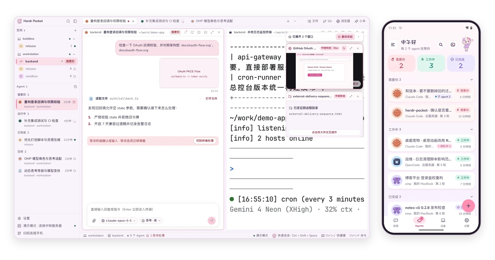

<p align="center">
  <a href="https://crosery.github.io/herdr-pocket/">
    
  </a>
</p>

<h1 align="center">Herdr Pocket</h1>

<p align="center">
  <strong>把每台电脑上的 AI 编程 Agent 装进口袋。</strong><br />
  从 iOS、Android、HarmonyOS NEXT、macOS、Windows、Linux 或任意浏览器，实时接管各台电脑上的 Claude Code、Codex、Gemini CLI、OpenCode、OMP 与终端会话。
</p>

<p align="center">
  <a href="https://github.com/Crosery/herdr-pocket/releases"></a>
  <a href="https://github.com/Crosery/herdr-pocket/actions/workflows/ci.yml"></a>
  <a href="LICENSE"></a>
  <a href="#安装包下载"></a>
</p>

<p align="center">
  <a href="README.md">English</a> &middot;
  <strong>简体中文</strong> &middot;
  <a href="#快速开始">快速开始</a> &middot;
  <a href="#安装包下载">安装包下载</a> &middot;
  <a href="docs/deploy/README.md">自托管文档</a> &middot;
  <a href="https://crosery.github.io/herdr-pocket/">官方网站</a>
</p>

<br />

<p align="center">
  <picture>
    <source media="(prefers-color-scheme: dark)" srcset="docs/readme/preview-dark.webp" />
    <source media="(prefers-color-scheme: light)" srcset="docs/readme/preview-light.webp" />
    
  </picture>
</p>

## 核心特性

- **不改变终端习惯的零侵入接入** — 在 macOS、Linux 与 Windows 电脑上继续使用原生的 `herdr` 运行 Claude Code、Codex、Gemini CLI、OpenCode、OMP 或普通 Shell；`hostd` 守护进程直接桥接 PTY 终端与 Uniflo 会话记录，并在手机端与桌面端统一同步 `/` 与 `\` 斜杠命令面板。
- **v3 分屏工作台与终端专属 60 FPS 浮窗** — 支持多栏对话 Diff 与原生 xterm 分屏、一键开启 Git Worktree 分支隔离；跨端悬浮窗口（`SessionPortalPiP`）按终端命令溯源并严格停靠在发起它的分屏格内，同时在 AI 操控 `ego-browser` 时直显 TaskSpace 空间状态与人工接管状态。
- **小羊助理与实时语音通话** — 7 态主动进度与卡点提醒、不打断主终端流量的 `/btw` 旁路追问，以及支持端侧降噪与声纹锁定的低延迟实时语音对话。
- **多空间浏览器与默认关闭插件中心（全闭出厂）** — 工作台内置 Space 隔离多标签浏览器与可选的闭合 Shadow DOM 虚拟光标、验证码人工接管保护；`browser_act`、`inspect_workspace`、SSRF 安全网页读取与密钥密封 Webhook 默认全部为 `false`，仅在你明确启用后生效。
- **自托管中转与加密 P2P 直连** — 受控电脑无需暴露任何公网端口；客户端自动探测局域网、Tailscale 或 WireGuard 组网链路并升级为 ChaCha20-Poly1305 / WebRTC 加密直连，不可直连时无感回落至自建中转。

## 快速开始

### 1. 部署你自己的中转服务器

支持 Docker、原生 Node + systemd、Fly.io、Render、Kubernetes 及免开端口的 Cloudflare Tunnel（详见 [部署文档](docs/deploy/README.md)）：

```sh
curl -fsSL https://raw.githubusercontent.com/Crosery/herdr-pocket/main/scripts/install-relay.sh | sudo bash -s -- --domain pocket.example.com
```

### 2. 在受控电脑接入 `hostd`

**macOS / Linux：**

```sh
curl -fsSL https://raw.githubusercontent.com/Crosery/herdr-pocket/main/scripts/install-host.sh | bash -s -- --server https://pocket.example.com
```

**Windows (PowerShell)：**

```powershell
& ([scriptblock]::Create((irm https://raw.githubusercontent.com/Crosery/herdr-pocket/main/scripts/install-host.ps1))) -Server https://pocket.example.com
```

*中国大陆网络环境：* 在脚本地址前拼接 `https://ghfast.top/` 即可加速拉取；安装后运行 `herdr-pocket update --probe` 可自动测速并记住最快的镜像源。

### 3. 在手机、桌面端或浏览器打开

从下方 [安装包下载](#安装包下载) 安装对应客户端，运行 `herdr-pocket pair` 扫码或打开配对链接加入，或直接在任意浏览器访问 `https://<你的中转域名>/app/`。

## 安装包下载

全部多端产物均由 GitHub Actions 自动构建并附带 `SHA256SUMS` 与中英文更新日志，完整历史版本见 [GitHub Releases](https://github.com/Crosery/herdr-pocket/releases)。

| 平台 | 架构 / 格式 | 直接下载链接 | 说明 |
| --- | --- | --- | --- |
| **macOS** | Apple Silicon (`arm64`) `.dmg` | [herdr-pocket-0.2.59-macos-arm64.dmg](https://github.com/Crosery/herdr-pocket/releases/download/v0.2.59/herdr-pocket-0.2.59-macos-arm64.dmg) | Tauri v2 原生桌面端 |
| **macOS** | Intel (`x64`) `.dmg` | [herdr-pocket-0.2.59-macos-x64.dmg](https://github.com/Crosery/herdr-pocket/releases/download/v0.2.59/herdr-pocket-0.2.59-macos-x64.dmg) | Intel Mac 桌面端 |
| **Windows** | `x64` NSIS 安装器 `.exe` | [herdr-pocket-0.2.59-windows-x64-setup.exe](https://github.com/Crosery/herdr-pocket/releases/download/v0.2.59/herdr-pocket-0.2.59-windows-x64-setup.exe) | 推荐的标准安装向导 |
| **Windows** | `x64` `.msi` 安装包 | [herdr-pocket-0.2.59-windows-x64.msi](https://github.com/Crosery/herdr-pocket/releases/download/v0.2.59/herdr-pocket-0.2.59-windows-x64.msi) | 静默 / MSI 批量部署 |
| **Linux** | `x64` `.AppImage` | [herdr-pocket-0.2.59-linux-x64.AppImage](https://github.com/Crosery/herdr-pocket/releases/download/v0.2.59/herdr-pocket-0.2.59-linux-x64.AppImage) | 免安装便携镜像 |
| **Linux** | `x64` Debian / Ubuntu `.deb` | [herdr-pocket-0.2.59-linux-x64.deb](https://github.com/Crosery/herdr-pocket/releases/download/v0.2.59/herdr-pocket-0.2.59-linux-x64.deb) | `apt` / `dpkg` 安装包 |
| **Android** | `arm64` `.apk` | [herdr-pocket-0.2.59-android-arm64.apk](https://github.com/Crosery/herdr-pocket/releases/download/v0.2.59/herdr-pocket-0.2.59-android-arm64.apk) | 支持应用内更新与语音通话 |
| **HarmonyOS NEXT** | `arm64` `.hap` | [herdr-pocket-0.2.59-harmonyos-arm64.hap](https://github.com/Crosery/herdr-pocket/releases/download/v0.2.59/herdr-pocket-0.2.59-harmonyos-arm64.hap) | Stage 模型 ArkTS 客户端 |
| **iOS** | `arm64` `.ipa` | [herdr-pocket-0.2.59-ios-arm64.ipa](https://github.com/Crosery/herdr-pocket/releases/download/v0.2.59/herdr-pocket-0.2.59-ios-arm64.ipa) | 支持 AltStore / SideStore / TrollStore |
| **中转与守护进程** | 跨平台源码包 `.tar.gz` | [herdr-pocket-0.2.59.tar.gz](https://github.com/Crosery/herdr-pocket/releases/download/v0.2.59/herdr-pocket-0.2.59.tar.gz) | 供 `install-host` 与 `herdr-pocket update` 使用 |

## 系统架构与安全边界

```mermaid
flowchart LR
  Clients["多端客户端: iOS · Android · HarmonyOS NEXT · 桌面端 · Web"]
  Relay["自建中转 Relay (wss + 小羊助理 + /app)"]
  Hostd["受控电脑 hostd (PTY + Uniflo + P2P 视窗 + 浏览器)"]
  Agents["CLI Agent: Claude Code · Codex · Gemini · OpenCode · OMP"]

  Clients <-->|"TLS WebSocket 主动外连"| Relay
  Relay <-->|"TLS WebSocket 主动外连（电脑免开端口）"| Hostd
  Clients <-.->|"加密 P2P 直连（局域网 / Tailscale / WebRTC）" .-> Hostd
  Hostd <--> Agents
```

- **仓库模块划分**：
  - `packages/protocol`：跨端版本化设备、Agent、对话流、RPC 与浮窗传送门线协议。
  - `apps/relay`：Node.js + SQLite 中转服务，仅存设备凭证 `SHA-256` 哈希，使用 `<db>.key` 密封存储助理配置与 API 密钥，并托管 H5 客户端（`/app/`）。
  - `apps/hostd`：受控电脑守护进程，负责桥接本地 `hc` PTY、`Uniflo` 记录、Git Worktree 创建、终端专属浮窗流与按需启用的 `herdr-pocket browser`。
  - `apps/desktop`、`apps/mobile`、`apps/harmony`：Tauri v2 原生桌面端、Expo SDK 58 移动端与鸿蒙 ArkTS 原生壳。
- **安全与信任模型**：
  - **自托管中转边界**：客户端与电脑通信全程 TLS 传输加密（直连路径为 ChaCha20-Poly1305 / DTLS）；中转转发路径需在服务端内存中交换消息，不面向运维方做盲盒端到端密文，这也是项目优先提供两分钟一键自托管、把服务器完全交由你掌控的原因。
  - **出厂默认零启用**：所有浏览器操控与小羊插件默认关闭；网页抓取严格校验证书与目标 IP 以拦截内网私网 SSRF 请求；Webhook 与模型密钥落盘前统一加密并在接口回读中脱敏。

<details>
<summary>按需浏览器操控 CLI（<code>herdr-pocket browser</code>）与插件说明</summary>

开启 `plugins.aiBrowser` 后，Agent 或自动化脚本可通过标准 CLI 驱动 Space 浏览器：

```sh
herdr-pocket browser status --json
herdr-pocket browser open http://localhost:3000 --space work --page app
herdr-pocket browser snapshot --space work --json
herdr-pocket browser click @e12 --space work --label "提交登录"
herdr-pocket browser fill @e14 "hello" --space work
herdr-pocket browser handoff --space work --reason "需要人工完成短信验证"
herdr-pocket browser resume --space work
```

</details>

## 本地开发与验证

```sh
pnpm install
pnpm typecheck
pnpm --filter @herdr-pocket/relay test
pnpm --filter @herdr-pocket/hostd test
pnpm --dir apps/desktop typecheck && pnpm --dir apps/desktop test
pnpm --dir apps/mobile typecheck
```

工程约定、UI 原语红线与发布流程见 [AGENTS.md](AGENTS.md)、[docs/README.md](docs/README.md) 及 [docs/design/ui-component-rules.md](docs/design/ui-component-rules.md)。

## 许可证

Copyright © 2026 Crosery

Herdr Pocket 以 [GNU Affero General Public License v3.0 only](LICENSE)（AGPL-3.0-only）发布：

- 可以自由使用、学习、修改和再分发，包括商用。
- 分发修改版（安装包、镜像、压缩包），必须以同样的协议附上完整源码。
- 只把修改过的中转服务或 App 部署出去让别人通过网络使用、不分发程序，也必须向这些用户公开修改后的源码。这一条是 AGPL 比 GPL 更严格的地方。
- 不能把它或它的一部分并进闭源产品。
- 本协议不授予 “Herdr Pocket” 名称和 Logo 的商标使用权。发布修改版请换一个名字和包名，不要让人误以为是官方版本。

**Additional permission under AGPL-3.0 section 7.** The website in `apps/site` may be combined with GSAP (distributed under its own “Standard no-charge” license), and the intro video project in `apps/site/video` with Remotion (distributed under the Remotion License), without those libraries falling under the AGPL. They keep their own terms: Remotion, for example, requires a paid company license above a certain team size. Neither library is used by the relay, the computer daemon or the mobile and desktop client apps.
