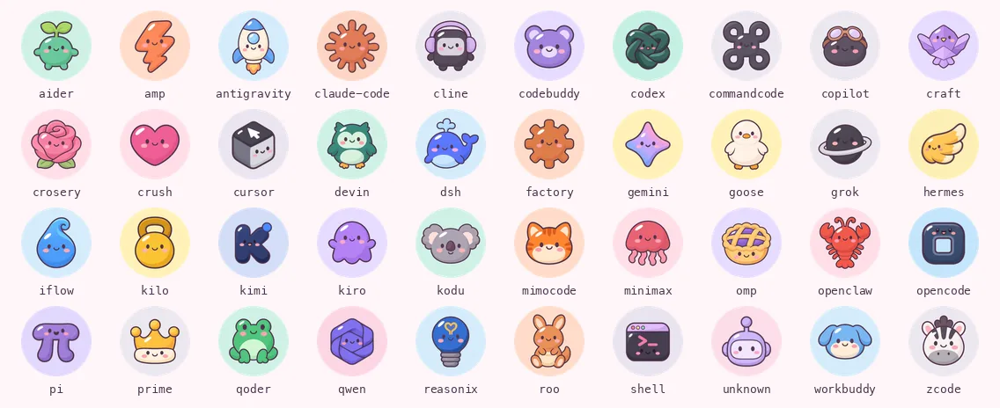

# Harness stickers

Every agent harness the clients recognise gets a round Pocket-style avatar: one original, chubby kawaii creature on a pastel disc, drawn in the same flat style as the rest of the set. The creature is inspired by the tool's colour or name; it is not the tool's logo, and a sticker never contains text, letters, numbers or a third-party mark. Two stickers are not tied to one harness: `shell.webp` for plain terminal programs and `unknown.webp` for any harness the clients do not know.



## Source and copies

The source folder is [`apps/mobile/assets/vendors/`](../../apps/mobile/assets/vendors/) (40 files). Every other copy is byte-identical to it:

| Copy | Path | How it is updated |
|---|---|---|
| Desktop | `apps/desktop/public/assets/vendors/` | Copy the files. |
| HarmonyOS NEXT | `apps/harmony/entry/src/main/resources/rawfile/assets/vendors/` (git-ignored) | `pnpm build:harmony` in `apps/desktop` copies the desktop public folder into rawfile. |
| Relay admin | `apps/admin/public/admin-assets/vendors/` | Copy the files, then `pnpm build` in `apps/admin`; it writes `apps/relay/src/admin/dist/admin-assets/vendors/`, which the relay serves. |
| Website | `apps/site/public/assets/vendors/` | Copy the files. `pnpm assets` in `apps/site` also copies them, but it re-encodes the mascot and brand files too, so do not run it just for stickers. |

To check the copies (prints nothing when they all match):

```sh
for f in apps/mobile/assets/vendors/*.webp; do
  n=$(basename "$f")
  for d in apps/desktop/public/assets/vendors apps/admin/public/admin-assets/vendors apps/site/public/assets/vendors; do
    cmp -s "$f" "$d/$n" || echo "differs or missing: $d/$n"
  done
done
```

## Mapping files

Three files map a harness to its sticker. Their ids, labels, colours, files and aliases must stay identical:

- [`apps/mobile/src/lib/harness.ts`](../../apps/mobile/src/lib/harness.ts): `IMG` (one `require` per file), `LOOKS` (`image:`) and `ALIASES`. Mobile `LOOKS` also carries monochrome brand marks (`svg:`), which the web clients do not have.
- [`apps/desktop/src/components/MascotAndVendor.tsx`](../../apps/desktop/src/components/MascotAndVendor.tsx): `LOOKS` (`sticker:`) and `ALIASES`.
- [`apps/admin/src/components/MascotAndVendor.tsx`](../../apps/admin/src/components/MascotAndVendor.tsx): `LOOKS` (`sticker:`) and `ALIASES`, the same as desktop.

`LOOKS` is keyed by the Uniflo harness id; `ALIASES` maps program names that herdr reports (`claude-code`, `droid`, `oh-my-pi`, …) to that id. The website's "Supported agents" strip is a separate list in `initMarquee()` in [`apps/site/src/sections.ts`](../../apps/site/src/sections.ts), with Shell kept last.

## Colours

The disc is filled with the harness's light pastel from `LOOKS`. The clients draw the sticker on a tile of that same colour (round on mobile and desktop, a rounded square in the admin), so a disc in any other colour shows as a rim or as coloured corners.

| Name | Light (disc and tile) | Dark tile |
|---|---|---|
| Peach | `#FFDCCB` | `#5A3A33` |
| Lavender | `#E6DCFF` | `#41365C` |
| Mint | `#CFF1E5` | `#244339` |
| Sky | `#D4EBFB` | `#243F55` |
| Butter | `#FFF0B8` | `#4D4426` |
| Grey | `#ECE8F1` | `#3A3446` |
| Rose | `#FFDDE7` | `#4E2C3A` |

## Format

- 144 × 144 px lossy WebP with alpha.
- The disc is the inscribed circle, filling the canvas edge to edge with an anti-aliased rim; outside it is transparent.
- The disc colour is exactly the harness's light pastel.
- About 3.5–5.5 KB per file (the current set is 3.4–5.8 KB).
- One centred character that fits the middle 60 % of the disc and still reads at 40 px.

## Adding a harness

1. Pick the id (the Uniflo harness id), the label and one of the seven pastels. Prefer a colour that keeps the new sticker distinct from the ones next to it in the list.
2. Generate a 1024 × 1024 square with an image model, using the set's shared prompt below. Put the pastel's hex in `<pastel>` and a short description of an original creature in `<character>`, with its main colour as a hex value. Passing an existing sticker as a style reference keeps the outline and face consistent.

   > App avatar icon for a cute pastel Android app, kawaii sticker style. Square canvas filled edge to edge with ONE flat solid background colour `<pastel>`, no border, no ring, no frame, no vignette, no background shadow. In the exact centre, one chubby kawaii character glyph: `<character>`. The glyph is made of soft puffy rounded shapes with a clean dark plum outline (#4A3550) of even medium weight, gentle soft cel shading and one small white highlight, plus a tiny happy face: two small dark oval eyes and two little pink blush ovals. The glyph fits well inside the central 60 percent of the canvas so it survives a circular crop. Bold simple silhouette that stays readable at 40 pixels. No text, letters, numbers or logos anywhere, no extra decorations, no sparkles, no confetti.

3. Post-process the render to the format above:
   1. Flood-fill the background from the edges to the exact pastel.
   2. Mask it to the inscribed circle, building the mask at 4× and downsampling it so the rim is smooth.
   3. Resize to 144 px with Lanczos.
   4. Encode with `cwebp -q 92 -alpha_q 100 -m 6 -sharp_yuv`, lowering `-q` if the file is over about 5.5 KB.
4. Review it on a contact sheet next to the existing set, at 96 and 48 px on the light (`#FFF6F9`) and dark (`#1C1722`) page colours. Redo it if the character fades into its disc at 48 px or the disc does not match its tile.
5. Save it as `<id>.webp` in the source folder and every copy above, and check the copies with the loop above.
6. Add the id to `LOOKS` in all three mapping files, plus `IMG` on mobile. Add any program names herdr reports for it to `ALIASES`, and add the harness to the website strip.
7. Rebuild the admin (`pnpm build` in `apps/admin`). Then run `pnpm typecheck` in `apps/mobile`, `apps/desktop`, `apps/admin` and `apps/site`, and `pnpm build` in `apps/site`.

## All stickers

| Harness id | Label | Colour | File |
|---|---|---|---|
| `aider` | Aider | Mint | `aider.webp` |
| `amp` | Amp | Peach | `amp.webp` |
| `antigravity` | Antigravity | Sky | `antigravity.webp` |
| `claude` | Claude Code | Peach | `claude-code.webp` |
| `cline` | Cline | Grey | `cline.webp` |
| `codebuddy` | CodeBuddy | Lavender | `codebuddy.webp` |
| `codex` | Codex | Mint | `codex.webp` |
| `commandcode` | Command Code | Grey | `commandcode.webp` |
| `copilot` | Copilot | Grey | `copilot.webp` |
| `craft` | Craft Agents | Lavender | `craft.webp` |
| `crosery` | Crosery Agent | Rose | `crosery.webp` |
| `crush` | Crush | Rose | `crush.webp` |
| `cursor` | Cursor | Grey | `cursor.webp` |
| `devin` | Devin | Mint | `devin.webp` |
| `dsh` | DeepSeek Harness | Sky | `dsh.webp` |
| `factory` | Factory Droid | Peach | `factory.webp` |
| `gemini` | Gemini | Butter | `gemini.webp` |
| `goose` | Goose | Butter | `goose.webp` |
| `grok` | Grok | Grey | `grok.webp` |
| `hermes` | Hermes | Butter | `hermes.webp` |
| `iflow` | iFlow | Sky | `iflow.webp` |
| `kilo` | Kilo Code | Butter | `kilo.webp` |
| `kimi` | Kimi | Sky | `kimi.webp` |
| `kiro` | Kiro | Lavender | `kiro.webp` |
| `kodu` | Kodu | Mint | `kodu.webp` |
| `mimocode` | MiMo Code | Peach | `mimocode.webp` |
| `minimax` | MiniMax Code | Rose | `minimax.webp` |
| `omp` | omp | Lavender | `omp.webp` |
| `openclaw` | OpenClaw | Rose | `openclaw.webp` |
| `opencode` | OpenCode | Sky | `opencode.webp` |
| `pi` | Pi | Lavender | `pi.webp` |
| `prime` | Prime Agent | Grey | `prime.webp` |
| `qoder` | Qoder | Mint | `qoder.webp` |
| `qwen` | Qwen | Rose | `qwen.webp` |
| `reasonix` | Reasonix | Sky | `reasonix.webp` |
| `roo` | Roo Code | Peach | `roo.webp` |
| `(shell)` | 终端 (terminal) | Grey | `shell.webp` |
| `(any other)` | the harness's own name | Rose | `unknown.webp` |
| `workbuddy` | WorkBuddy | Sky | `workbuddy.webp` |
| `zcode` | ZCode | Grey | `zcode.webp` |
